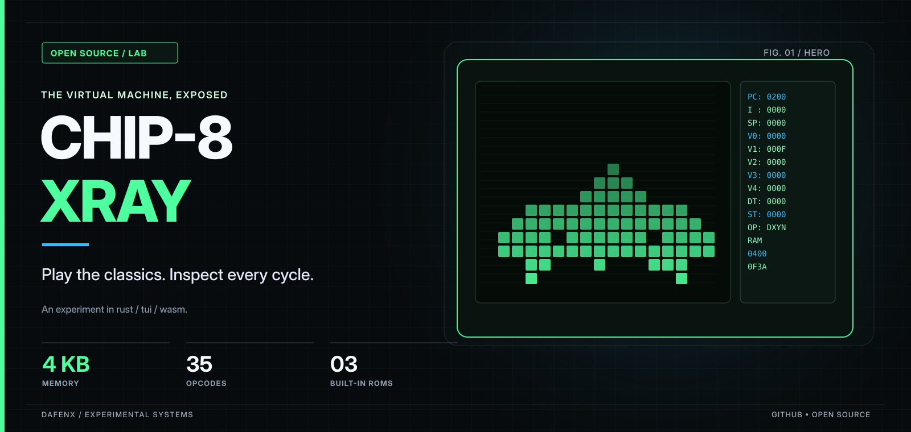
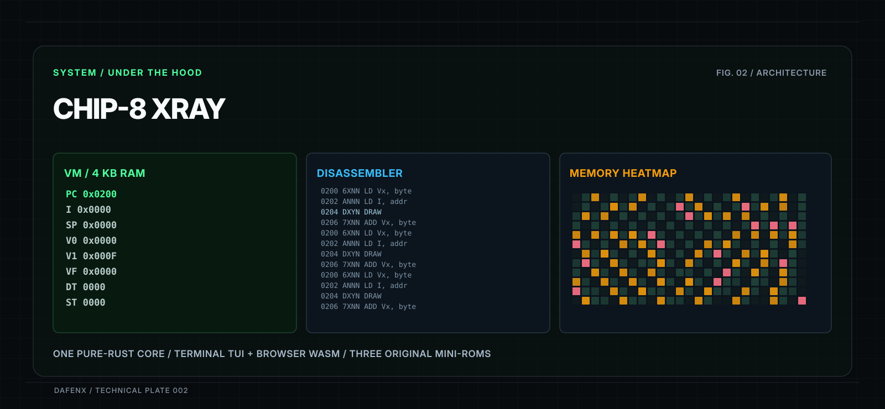

<p align="center">
  
</p>

<p align="center">
  <a href="https://github.com/Dafenxz0/chip8-xray/actions/workflows/ci.yml"></a>
  <a href="https://dafenxz0.github.io/chip8-xray/"></a>
</p>

# chip8-xray

### Play the VM. Inspect the machine.

A Rust CHIP-8 emulator with an **X-ray debugger**: watch the framebuffer, registers, disassembly and RAM activity at the same time. Run it as a terminal TUI or in your browser through WebAssembly.

<p align="center"><a href="https://dafenxz0.github.io/chip8-xray/"><strong>OPEN THE WEB EMULATOR</strong></a></p>



## What's under the hood?

| Element | Implementation |
| --- | --- |
| 4 KB RAM / 16-level stack | One pure-Rust VM core |
| 64 × 32 monochrome display | Shared framebuffer exposed to both UIs |
| 35 classic CHIP-8 opcodes | Fetch/decode/execute and disassembler |
| 16-key hexadecimal keypad | Browser and terminal keyboard mappings |
| Delay + sound timers | Timed VM state |
| Per-byte RAM heat | 4096-element activity tracking buffer |

Three original ROMs are bundled and assembled directly in Rust: **Bounce**, **10PRINT Maze**, and **Target Shooter**. No third-party ROM downloads are required to try the emulator.

## Run in your terminal

```bash
git clone https://github.com/Dafenxz0/chip8-xray.git
cd chip8-xray
cargo run --release
```

Run headlessly to exercise the VM without the terminal interface:

```bash
cargo run -- --headless --cycles 500
cargo test
```

### Terminal controls

| Key | What it does |
| --- | --- |
| `Space` | Pause / run |
| `N` | Step one CPU cycle |
| `R` | Reset selected ROM |
| `1` / `2` / `3` | Bounce / Maze / Shooter |
| `+` / `-` | Change cycles per tick |
| `W` / `S` or `↑` / `↓` | Bounce paddle input |
| `A` / `D` or `←` / `→` | Shooter move |
| `F` / `Enter` | Shooter fire |
| `Q` / `Esc` | Quit TUI |

## Run the browser build

**[Try the live browser emulator →](https://dafenxz0.github.io/chip8-xray/)**

Or compile the same Rust VM for `wasm32`:

```bash
rustup target add wasm32-unknown-unknown
cargo build --lib --target wasm32-unknown-unknown --release
cp target/wasm32-unknown-unknown/release/chip8_xray.wasm web/chip8_xray.wasm
python3 -m http.server 8080 --directory web
```

Open `http://localhost:8080`. The browser edition has a clickable hex keypad, CRT overlay and a **64 × 64 memory heatmap**, in addition to the register and disassembly inspector.

## Debugger data flow

The VM in [`src/cpu.rs`](src/cpu.rs) exposes execution state. [`src/roms.rs`](src/roms.rs) contains the two-pass ROM builder and built-in programs, while [`src/wasm.rs`](src/wasm.rs) exports shared memory to the browser frontend. [`src/main.rs`](src/main.rs) provides the Ratatui/Crossterm terminal UI.

The artwork above is a conceptual debugger plate rather than a screenshot. The disassembler strings shown there are illustrative.

## Test it

```bash
cargo fmt --all -- --check
cargo clippy --all-targets -- -D warnings
cargo test
cargo run -- --headless --cycles 500
```

This project aims at **classic CHIP-8 behavior**, not every historical CHIP-8 variant or Super-CHIP extension.
